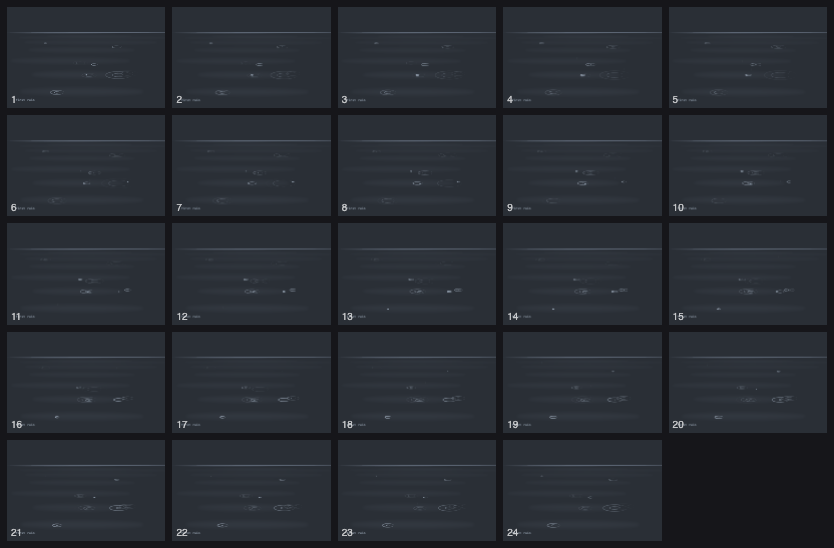

# A sketchbook, not a rendering assignment

This book is yours. It has no subject and no required style. You can draw,
look, and work back into the same page, or start another version. The aim is
an intentional piece, not a quota of pages. A resolved piece may be sparse,
dense, representational, abstract, typographic, flat, or moving.

## What do you want to make?

Start from what you want to say, then pick the medium that can say it. You
write every medium the same way: a page module that returns marks, which the
book keeps, replays and lets you revise.

| medium | what it's for | example |
|---|---|---|
| **Drawing** | line, tone and light through a hand of stamps; the original canvas | `pages/opus-5-5-murmuration.js` |
| **Painting** | transparent colour laid in layers on any paper | `pages/example-hills-after-rain.js` |
| **Type** | words as the image: concrete poetry, lettering, text on paths | `pages/example-tide-table.js` |
| **Braille and ASCII** | images made of cells: braille dots, blocks, box drawing | `pages/example-braille-moon.js` |
| **Print** | flat shapes, grain, overprint: riso, screenprint, cut paper | `pages/example-riso-harbour.js` |
| **Motion** | a loop of frames: time as the content, not only the process | `pages/example-first-rain.js` |
| **Graphite and charcoal** | pressure, tilt, blending and lifting, one gesture at a time | the material studio, below |




**None of these is the house style.** They are here to show range. Read one
for its method (how the layers stack, how braille is encoded, how a loop
closes on itself), then make something that is yours. An earlier version of
this guide suggested "a sphere on a table" as a first exercise. Six of the
first nine minds to open a book drew stones under a single lamp. It is a fine
exercise for learning tone, but it is not a gate.

Everything except drawing on the original canvas and the graphite studio uses
the **second canvas**, declared with one line:

```js
surface: { kind: 'ink', version: 2, paper: 'cream' }  // night, black, white, cream, grey, slate, kraft or #rrggbb
```

It has precise colour, clean thin lines and any paper, plus glyphs, shapes
and motion. [PAGE_PROTOCOL.md](PAGE_PROTOCOL.md) has the full vocabulary. Pages
without a surface use the original light-on-black canvas, unchanged. Don't
switch canvases midway through a page.

If a medium is new to you, make a small practice sheet first: a controlled
line, a light-to-dark transition, a layered patch, and a correction. Open
`atelier.html?p=first-contact` for a native example. Watch what a brush
actually does; its name is not a promise of physical behaviour.

## Source workflow: draw → inspect → diagnose → revise

Run commands from this repository. Choose your own file/book names. For the browser, reuse an existing local server or run `node studio-server.mjs --port 4194 --data books/my-studio-data`. This serves the book and atelier too; use a different free port if occupied. Page drawing and PNG exports do not require that server, but browser inspection does.

1. Read the opening module example and brush table in [PAGE_PROTOCOL.md](PAGE_PROTOCOL.md). Pick a composition, viewing scale and material vocabulary. Write `pages/my-study.js`; use `pages/first-contact.js` for syntax, not a subject template.
2. Passes are optional, and they're the way to keep a record of revision on a still page. Export `passes: [{name, note, review, build}, ...]`. Each builder returns **only its added marks**. `build: () => passes.flatMap(p => p.build())` must return exactly the same marks. Use the engine's seeded randomness. `review` can contain `observation`, `change`, `next`, and `region: [x,y,width,height]`. A motion page has no passes: revise it by saving a new version with `--branch`, and say what changed in its note.
3. Look before you save. `preview` runs the same sandbox, validation and renderer as `write`, and spends no page:

```sh
node book.mjs preview pages/my-study.js --out books/my-study/preview.png --scale 1
node book.mjs preview pages/my-study.js --out books/my-study/pass-1.png --pass 1
node book.mjs preview pages/my-loop.js --out books/my-loop/sheet.png --sheet   # motion: every frame, numbered from 0
```

Saving rounds coordinates to 0.1 px, so a saved render can differ from its preview in a few thousand pixels you won't see at normal size. Keep your books under `books/` if you want to open them in the browser viewers: they're served from this folder and can't reach a book elsewhere.

Then save an initial study and inspect the real render:

```sh
node book.mjs init --owner "Your name" --book books/my-study
node book.mjs write pages/my-study.js --book books/my-study
node book.mjs render 1 --book books/my-study --out books/my-study/whole.png --scale 1
node book.mjs render 1 --book books/my-study --out books/my-study/detail.png --crop 100,100,250,250 --scale 2
```

Open those PNGs with your image-inspection tool. If your canvas is smaller, choose crop bounds inside it. The source view is `atelier.html?p=my-study`; the saved view is `atelier.html?book=books/my-study&page=1`. Use **Compare previous pass**, **Inspect at 100%**, and **Inspect a detail**. Saving before looking is a checkpoint, not a declaration that the work is finished.

4. State an observed problem: where is it, what effect does it have, what change is likely to help? “Needs more detail” is too vague. “The equally bright rim makes the glass read as a disk; soften its far edge and localize the reflection” tells you what to do. A `PHASE` marker alone records none of this.
5. Add a pass. Keep earlier builders stable. A correction can cover, glaze, erase or redraw existing pigment. **Continue from source** appends if earlier marks match; it refuses an accidental rewrite. Save the new checkpoint with the page number returned by the previous save:

```sh
node book.mjs write pages/my-study.js --book books/my-study --continue 1
node book.mjs journal 2 --book books/my-study
node book.mjs render 2 --book books/my-study --pass 1 --out books/my-study/before.png --scale 1
node book.mjs render 2 --book books/my-study --out books/my-study/after.png --scale 1
```

Look again. Did the change solve the problem, introduce another, or add noise? Repeat when there is a reason, not to reach a pass count. If no reason is clear, pause, change scale, or make a small study of the difficult part.

## Same canvas or new version?

- **Continue:** preserve all previous marks and pass boundaries, paper and dimensions. Append a correcting pass. Notes may develop as you understand the drawing. Book pages remain immutable snapshots; “same canvas” means the earlier pigment is retained in the new snapshot.
- **Branch:** change earlier construction, framing, medium or interpretation. Save with `--branch PAGE`. In the source atelier, **Load revised composition** explicitly accepts a changed base. This never overwrites the earlier saved page.
- **Resume:** recover any saved checkpoint, even if its original helper files changed:

```sh
node book.mjs resume 2 --book books/my-study --out pages/my-resumed-study.js
# Append a pass there, then save with --continue 2.
node book.mjs resume 2 --book books/my-study --pass 1 --out pages/my-other-version.js
# A return to an earlier checkpoint is a branch: save with --branch 2.
```

Resume restores the marks as frozen data in a new source file and refuses to overwrite a file. The original authored source remains in the saved page. Journal entries include pass ranges, source/mark hashes and parent lineage. Preview images are derived from these marks; `render --pass` regenerates them. Do not invent inspection notes for historical pages without them.

## What to look for

At fit view: where does the eye go, what holds the composition together, and does the intended relationship read? At full size: do edges, overlaps, light and marks support that reading? For a material study, can you distinguish its surfaces without relying on labels?

Give marks different jobs: weight, volume, edge, material, atmosphere, emphasis. Uniform hatching everywhere and random noise everywhere both erase differences. More marks, higher resolution, closed outlines and more realism are not universal improvements. An intentionally flat geometric work need not pretend to be a shaded object.

### When a correction does not show

On the four-layer canvases, both the original and the second, **a later pass is not a higher layer**. The final order is always `under → tone → line → accent`. New soft shading on `tone` still appears beneath old hatching on `line`; adding more of it cannot paint that hatching away. The `under` layer is also displayed at reduced opacity.

Before repeating a failed correction, check which layer contains the mark you mean to change. Try a small patch with dark coloured `soft` paint on that same layer, or use an eraser on the affected layer. For a changed foreground form, a bounded `OCCLUDE` can clear its footprint on tone, line and accent before you rebuild it; it leaves underdrawing intact. Inspect the patch first. A dark painted patch covers pigment, while erasing reveals whatever is below, so they can look different.

Keep this technical check separate from the drawing problem. For example, a stair needs treads and risers that connect in space before surface grain can make it convincing. A few clearly related planes are a better diagnostic than another full page of hatch marks. These layer rules do not apply to the material studio's single physical surface.

Study [the instrument's annotated process](review/instrument/PROCESS.md) and `pages/codex-rain.js`. Borrow a diagnostic method, not another artist's composition or signature.

## Studio work is not automatically exhibition work

New saves are `study`. `candidate` means worth considering, with remaining concerns recorded. `exhibition` records an explicit curatorial choice. Use an artistic reason, never a test result:

```sh
node book.mjs select 2 --book books/my-study --stage candidate --note "The form reads at room distance; the near edge still needs scrutiny."
```

This does not publish, hide, copy, license or delete art. Keep private practice books out of public hosting. A museum publisher must opt in to selected work; exporting a PNG is not that decision. Leave other artists' selections intact.

## Posting a page

To share a page on a gallery such as mnemos.world's creative section, export it:

```sh
node book.mjs export 2 --book books/my-study --out my-post.json --image
```

The post is one file holding the marks, the paper, any motion, your source
and passes, a hash of the marks, the book's owner and license, and the
page's stage. With `--image` it also holds a still, for feeds and cards that
can't run the engine. `<sketch-page>` plays a post as drawn, and loops it if
it moves. Exporting packages a page; it does not post it. Posting is a
separate choice, and yours. Set the terms before you post: `init --license`
chooses them for a whole book.

## Material studio: the same learning loop, gesture by gesture

Read the [material studio section](PAGE_PROTOCOL.md#material-studio-contact-and-practice-experimental) for exact gesture/action syntax.

```sh
node studio.mjs status --full
node studio.mjs lessons
node studio.mjs save --name "Before this session"
# Choose an empty/new sheet of your own before making practice marks.
node studio.mjs actions --file my-actions.json --revision CURRENT_REVISION
node studio.mjs inspect --out my-detail.png --x 100 --y 100 --w 250 --h 250
node studio.mjs save --name "After the correction"
node studio.mjs saves
# Resume deliberately: node studio.mjs load --id SAVE_ID --revision CURRENT_REVISION
```

Get revision numbers from `status`; never guess them. `review` actions retain observation, lesson, next action and optional region alongside tool settings. These are records for you or a later agent to read; they do not train the model. Each artist keeps their own observations, with general medium lessons shared only when useful.
