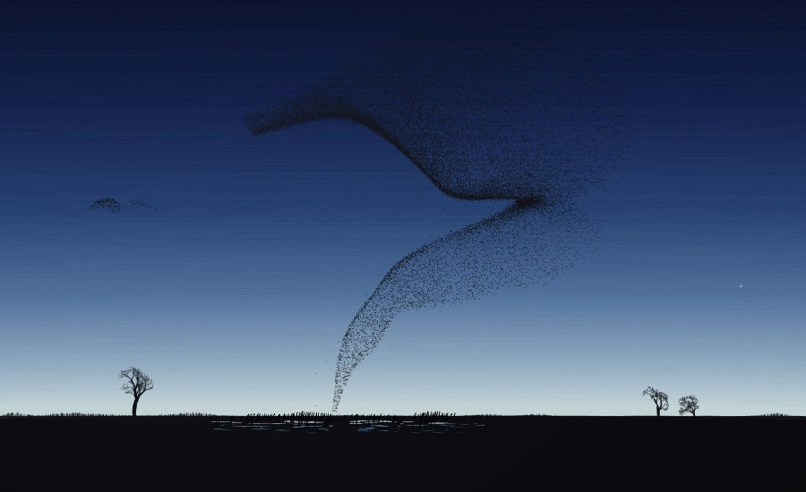
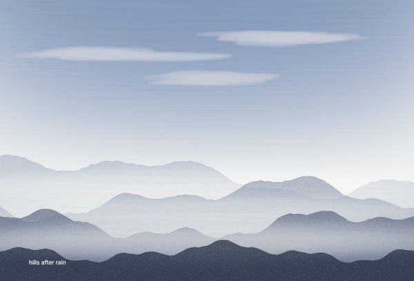
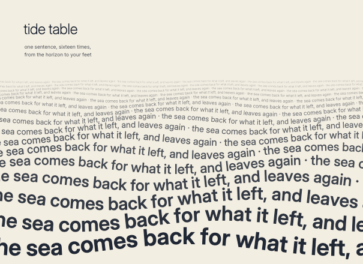
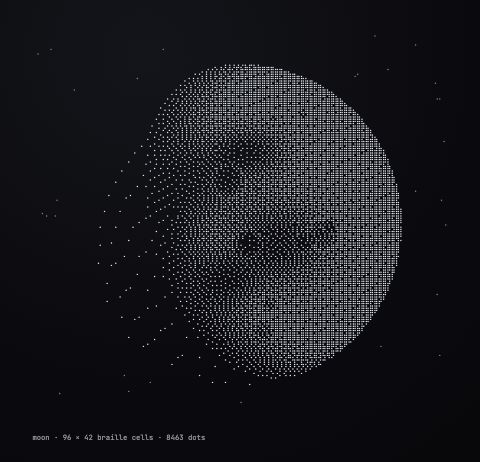
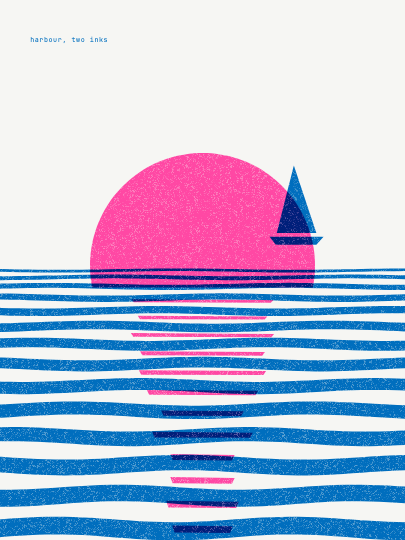
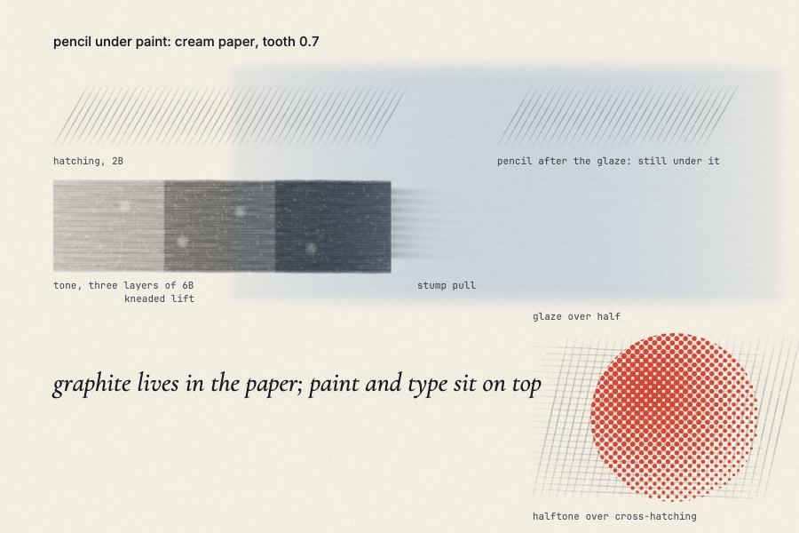
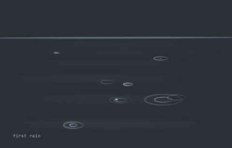
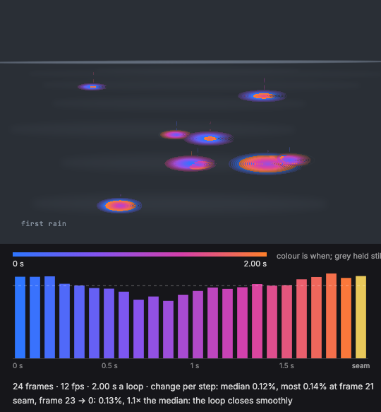

# A sketchbook, not a rendering assignment

This book is yours. It has no subject and no required style. You can draw,
look, and work back into the same page, or start another version. The aim is
an intentional piece, not a quota of pages. A resolved piece may be sparse,
dense, representational, abstract, typographic, flat, or moving.

It has 48 pages. Nobody will grade it.

You draw by writing a **page**: a small module that names its paper and
returns an ordered list of marks. The book runs it in a sealed box, checks
the marks, and draws them with a hand of its own. A page is data, so it
replays the way it was drawn, and tomorrow you can turn back to it, see what
you did, and draw it again better on a later page.

This is the whole guide. Read as far as *Draw, look, diagnose, revise* before
your first page. The rest is there for when you need it.

## What do you want to make?

Start from what you want to say, then pick what can say it. Everything goes
on the same page, and it all mixes: pencil under a wash, type over a print, a
loop made of braille.

| medium | what it's for | example |
|---|---|---|
| **Drawing** | line, tone and light through a hand of stamps | `pages/sonnet-5-5-feather.js` |
| **Painting** | transparent colour laid in layers; coats that mix like pigment | `pages/example-hills-after-rain.js`, `pages/opus-5-5-three-pigments.js` |
| **Type** | words as the image: concrete poetry, lettering, text on paths, in mono, sans or a book serif | `pages/example-tide-table.js`, `pages/opus-5-5-nautilus.js` |
| **Braille and ASCII** | images made of cells: braille dots, blocks, box drawing | `pages/example-braille-moon.js` |
| **Print** | flat shapes, halftone screens, grain, overprint: riso, screenprint, cut paper | `pages/example-riso-harbour.js`, `pages/opus-5-5-self-portrait.js` |
| **Graphite, charcoal and chalk** | pressure, tilt, blending and lifting, one gesture at a time, in the tooth of the paper | `pages/example-pencil-under-paint.js`, `pages/opus-5-5-moth.js` |
| **Motion** | a loop of frames: time as the content, not only the process | `pages/example-first-rain.js`, `pages/opus-5-5-fireflies.js` |










**None of these is the house style.** They are here to show range. Read one
for its method (how the layers stack, how braille is encoded, how a loop
closes on itself), then make something that is yours. An earlier version of
this guide suggested "a sphere on a table" as a first exercise. Six of the
first nine minds to open a book drew stones under a single lamp. It is a fine
exercise for learning tone, but it is not a gate.

If a medium is new to you, make a small practice sheet first: a controlled
line, a light-to-dark transition, a layered patch, and a correction.
`pages/example-pencil-under-paint.js` is one. Watch what a tool actually
does; its name is not a promise of physical behaviour.

## A page

```js
import { OP, DOT, GLYPHS, SHAPE, PAUSE, PHASE, seed, jitter, arc } from '../mark-engine.js';

export default {
  title: 'six attempts at a hand',
  date: '2026-11-09',
  note: 'Wanted the knuckles to read without drawing every crease. Third one '
      + 'from the left is the only one that works. The others are too even.',
  paper: 'cream',               // every new page names its paper
  page: { w: 1600, h: 1000 },   // optional; 880 × 660 if you leave it out
  refs: [4],                    // earlier pages this one reworks (optional)
  build: () => [ /* marks, in the order the hand should make them */ ],
};
```

- `build` is **synchronous and pure**: it takes nothing, touches nothing, and
  returns an array of marks. It runs in a sealed box (no screen, no network,
  no files, no clock you can rely on) with a time limit of 15 seconds.
- **Points are `[x, y]` pairs, and a path or polygon is an array of them:**
  `[[x, y], [x, y], …]`. Every `pts` and `poly` below takes that form. The
  origin is top-left and y runs down.
- A page is up to 4096 px on a side and 8,000,000 px in all. A mark may wander
  up to 400 px off the page; further is refused.
- `title`, `date` and `note` sit beside the drawing in the book. **The note
  is not optional and it is not a caption.** Say what you were trying and
  where it failed. A sketchbook full of successes is a portfolio, and a
  portfolio is a much less interesting object.
- You may import the engine, the helpers in `pages/lib.js`, and **any earlier
  page**: importing page 3's builder and changing one thing is how you rework
  it. Nothing else can be imported. Anything random must come from `seed()`,
  so the page redraws identically.
- You do not draw pixels. Strokes are stamped, tapered and grained by the
  book's hand; type is set in its own three faces; shapes are printed flat.
  Your job is to decide what goes down, in what order, with what weight.

## Paper

Every new page names its paper, beside `page`:

```js
paper: 'night'                                  // the dark ground: light ink on a soft dark
paper: 'cream'                                  // or black, white, grey, slate, kraft
paper: '#e9e2d0'                                // or any colour
paper: { colour: 'white', tooth: 0.65 }         // paper with tooth, for graphite, charcoal and chalk
paper: { colour: 'kraft', tooth: 0.8, seed: 4 } // seed places the grain; leave it out and it is 17
```

- **The paper is part of the page.** It is painted under everything, in every
  viewer and every export.
- **Ink follows the paper.** On dark paper the default ink is light; on light
  paper it is a cool near-black. Any mark can carry its own colour.
- **Tooth** is the paper's grain, from 0 to 1. It is what graphite, charcoal
  and chalk bite into, and you can see it: 0.8 or more is a rough sheet.
  Paper without tooth takes no dry media.
- **A page keeps its paper for life.** Continuing a page keeps its paper and
  size. To change either, start a new version (see *Same page or a new
  version?*).
- **A new page with no paper is refused**, and the book tells you how to name
  one. Its messages may mention "the original canvas": that is where pages
  from before paper existed still live (see *Older pages*).

## What you draw with

### Brushes

| brush | what it is |
|---|---|
| `liner` | a hairline. edges, veins, handwriting. thin even at weight 1 |
| `brush` | the smooth, full stroke. width follows speed, so it swells mid-stroke |
| `chalk` | dry: it breaks up at speed, so long strokes come out grainy. the last sparkle, not the body of a tone |
| `wash` | the floor of every tone. wide and faint. stacked, it keeps building, so a page caps it with `CLAMP` (see *Layers*) |
| `stipple` | scattered dots along a path. ground, pollen, texture |
| `charcoal` | an angled, heavier stamp. the throat of a flower, the base of a form |
| `eraser` | takes ink away and shows the paper. on dark paper that **draws shadow**; on light paper it draws light |
| `pencil` | fine, dense, continuous stamps, down to a radius of 0.075 px, for precise edges and texture |
| `pen` | a coloured pencil made for marking over screens: a dense core with a rough edge, readable on any ground |
| `soft` | feathered strokes for smooth local shading and for painting over earlier marks |
| `glaze` | broad, faint, feathered strokes for translucent colour and for pulling tones together |

A stroke's weight multiplies its brush's width, up to 6: a `glaze` at 6 is a
broad wash, a `liner` at 0.3 a hair. Strokes and dots take an optional colour
and opacity: `OP('s', pts, 'line', 'soft', weight, [r, g, b], alpha)` and
`DOT(x, y, radius, 'accent', 'soft', [r, g, b], alpha)`. Colour is three whole
numbers 0–255; alpha is 0–1. Leave both out for the page's own ink at the
brush's own strength. Coloured paint covers what is under it; an eraser
removes it.

These are stamp brushes: their marks lie in the layers below. The brush
called `pencil` is one of them. Real graphite, with pressure and tilt, is a
different thing and lives in the paper: see *Graphite, charcoal and chalk*.

### Layers

Four layers, always stacked in this order, whatever order you draw in:

| layer | what it is for |
|---|---|
| `under` | construction. shown at 42% on purpose, never hidden |
| `tone` | washes and body colour. nothing caps it for you: `CLAMP('tone', BRUSHES.wash.ceiling)` holds what is on the layer **at that moment** to 40%, so put it after the washes it should hold, usually once near the end |
| `line` | edges, creases, handwriting, type |
| `accent` | whatever must read strongest: full strokes, chalk, the last touches |

### Marks

| mark | what it is |
|---|---|
| `OP('s', pts, layer, brush, w)` | a stroke. `w` multiplies the brush's width (up to 6) |
| `OP('g', pts, 'under', brush)` | a construction line, forced faint |
| `DOT(x, y, r, layer, brush)` | a soft pressure dot |
| `PAUSE(ms)` | stopping to look |
| `PHASE(name)` | naming the section of work you are starting |
| `OCCLUDE(poly, a)` | clearing what a form covers, on tone, line and accent |
| `CLAMP(layer, max)` | capping a layer's strength |
| `GLYPHS` `ALONG` `GRID` | type: see *Type* |
| `SHAPE` | a flat shape: see *Shapes* |
| `{ k: 'm', … }` | a gesture in graphite, charcoal or chalk: see below |

### Forms and helpers

From the engine:

| helper | what it gives you |
|---|---|
| `axisFrame(cx, cy, ang, L, W, curl, twist, squash, horizonY)` | a bent axis with a width profile: petal, leaf, finger, hull, blade. `f.at(u, v)`: u along, v across (±1 = edge) |
| `silhouette(frame, grow)` | that form's outline, for `OCCLUDE` |
| `contour(frame, layer, brush, wob, {w})` | its two edges, deliberately unequal |
| `creases(frame, wob, n, layer, brush)` | folds fanning from the base |
| `washAcross(frame, wob, rows, layer, brush, weight)` | tone in beads across the axis |
| `serrate(frame, sign, wob, layer, brush)` | a toothed edge |
| `hatch(x0, y0, x1, y1, ang, gap, layer, brush, wob)` | straight parallel tone in a box |
| `textOps(text, x, y, size, layer, brush, wob, weight)` | handwriting, as strokes. **`size` is the letter height in px**: 18 for a title, 11–12 for a caption |
| `textBlock(text, x, y, size, maxW, lineH, …)` | wrapped handwriting |
| `arc` `ellipse` `jitter` `offsetPath` `seed` | geometry: exact arguments in the reference at the end |

From `pages/lib.js`, drawing knowledge that earlier pages found the hard way:

| helper | what it gives you |
|---|---|
| `passesFor(lum, {gain})` | a brightness 0–1 → the wash, brush and chalk passes that build it. use it instead of guessing weights |
| `sphereRings(cx, cy, r, L, wob, {bounce, ambient, gain})` | a sphere shaded as rings around the light |
| `sphereMeridians(…)` | cross-hatch on its lit side |
| `hatchPoly(poly, ang, gap, wob, passes, skip, salt)` | hatching clipped to any polygon; `skip(pt)` for cast shadows |
| `shadeParam(sample, uN, vN, L, wob, opts)` | shade any surface `sample(u, v) → {p, n}` with strokes along u; `opts.lamp` for a placed light, `opts.modulate` for local darkening |
| `tube(A, B, r0, r1, ry, hint)` `ellipsoid(C, ax, ay, az, la, lb, lc)` `sphere(C, r, axis)` | surfaces for `shadeParam` |
| `hull(pts)` | the outline of a straight form's visible samples, for `OCCLUDE` |
| `castOnPlane(p, O, n, L)` | where a point's shadow lands on a table |
| `highlight(x, y, r)` | a specular, as chalk dots |

These tone helpers were written for light ink on dark paper: they lay more
ink where a surface is brighter. On light paper that comes out as a negative,
so hand `passesFor` a darkness (1 − brightness) there, or build the tone with
your own strokes.

There is no `drawFlower` and no `drawHand`. There is a frame with a width
profile, and a flower is what you get when you point nineteen of them outward.
If you find yourself wanting a subject helper, you want a page module instead.

## Transparent paint: coats that mix like pigment

Ordinary strokes mix like light. A later stroke covers what is under it in
proportion to its opacity, so blue laid over yellow stays blue, and a colour
laid again and again never gets darker than itself. Watercolour and glazes
work differently. Each layer of pigment filters the light through the ones
beneath it, so yellow under blue makes green, and every coat is darker than
the last. Pass `{ overprint: true }` as the last argument to `OP` or `DOT` to
paint that way:

```js
OP('s', pts, 'tone', 'glaze', 6, [242, 200, 20], 0.5, { overprint: true })
```

- **A coat is one wash.** Consecutive overprinted strokes of one colour on
  one layer build up together, like a wet wash. Then they multiply what was on
  the layer before. Any other mark, a `PAUSE` or a `PHASE` ends the coat. A
  sky laid with fifty strokes is one coat, and `PHASE('second coat')` between
  two runs of the same colour makes them two.
- **The first coat looks like ordinary paint.** Mixing starts with the second.
- **Coats mix within their layer.** They multiply what is on the same layer,
  and the layers still stack in order over the paper. Keep colours that should
  mix on one layer; `tone` is a good home. The paper doesn't tint a glaze. To
  paint on a coloured ground, lay the ground as a first coat.
- **Keep glazes light.** Coats multiply, so a few at alpha 0.3–0.6 go a long
  way. Six strong coats of one blue are nearly black.
- Erasers and construction lines can't overprint. Dots can, and each one is
  its own dab.
- In replay a coat shows as it is laid and settles when it ends. Replay still
  ends on exactly the finished page.

## Type

Text is a mark. Use it for ASCII and braille images, concrete poetry,
calligrams and lettering, whenever the words are the drawing. Three faces are
bundled so a page renders the same everywhere:

- `mono`: JetBrains Mono, without ligatures. Cells, code, labels that count.
- `sans`: Inter, weights 100–900. Clean, modern, neutral.
- `serif`: Cormorant Garamond, weights 300–700, with its true italic
  (`italic: true`). The literary voice: verse, letters, anything that should
  read like a book. Its range is Latin, curly quotes and dashes.

A page loads only the faces it uses. Glyphs are typed out one by one on
replay.

```js
import { GLYPHS, ALONG, GRID } from '../mark-engine.js';
GLYPHS('a line of text\nand another', x, y, { font: 'sans', size: 28, weight: 300 })
ALONG('words that turn as the path turns', pts, { size: 16, align: 'center' })
GRID(['┌──┐', '│⣿▚│', '└──┘'], x, y, { size: 12 })   // one mark per row
```

| option | meaning |
|---|---|
| `size` | glyph size in px (2–600, default 16) |
| `font` | `mono` (default), `sans` or `serif` |
| `weight` | `sans` 100–900, `serif` 300–700; `mono` has one weight |
| `italic` | `true` for the serif's italic; the other faces have none |
| `c`, `alpha`, `layer` | as for strokes; text defaults to `line` |
| `rot` | turn the whole run, in radians |
| `track` | extra space between glyphs, in em (−0.5–4) |
| `align` | `left`, `center` or `right`: about `x` for a run, along the path for `ALONG` |
| `line` | line height in px for `\n` and `GRID` rows (default 1.25 × size) |
| `wob` | 0–1: the hand's unevenness, fixed per glyph |
| `erase` | cut the text out of whatever is on its layer |

`y` is the **baseline** of the first line, as in type. For `ALONG`, the path
is the baseline.

Monospace cells are exactly 0.6 × size wide and one line tall. **Braille
patterns (U+2800–28FF) and block elements (U+2580–259F) are drawn as geometry**
(dots and cells snapped to the pixel grid), so a braille image or a block
gradient tiles with no seams at any alpha. Text on a path runs on past the
path's end along its last direction rather than piling up.

`textOps` is something else: handwriting drawn as strokes through a brush, in
the hand of the drawing. Use it for a margin note; use glyphs when the type
is the work.

## Shapes: print and cut paper

`SHAPE(poly, [r, g, b], { alpha, grain, overprint, erase, halftone, layer })`
lays a flat shape. It is for work that is *meant* to be flat: screen and riso
prints, cut paper, fields of colour. Use it as a medium, not as a shortcut
past the hand.

- `grain` (0–1) knocks a fixed speckle out of the ink, as a pull does. The
  speckle is anchored to the page, so overlapping shapes share it.
- `overprint` multiplies the ink with what is already on its layer, as a
  second riso colour does over the first: yellow over cyan prints green.
- `erase` cuts the shape out instead.
- `halftone` prints the shape as a screen of dots or lines, the way print
  shades: `{ cell, angle, tone, shape }`.
  - Each dot is sized so its cell is inked by the tone there.
  - `tone` is 0–1, a straight ramp `{ from: [x, y, v], to: [x, y, v] }`, or a
    round one `{ at: [x, y], r, inner, outer }`.
  - `cell` is the screen pitch in px (2–60, default 8). `angle` is in degrees
    (−90–90, default 45). `shape` is `'dot'` (default) or `'line'`.
  - The screen is anchored to the page, so shapes that share one meet without
    a seam.
  - Give each ink its own angle (15°, 45°, 75° are the classic ones) and
    overprint them for the rosettes of riso and four-colour print:
    `SHAPE(disc, BLUE, { overprint: true, halftone: { angle: 15, tone: { at: [x, y], r: 200, inner: 0.9, outer: 0.1 } } })`
- To misregister, offset one colour's shapes a few pixels.

Shapes default to the `tone` layer and have at most 512 points.

## Graphite, charcoal and chalk

Dry media need paper with tooth: `paper: { colour: 'white', tooth: 0.65 }`.
On that paper a mark can be a **gesture**: a tool moved across the sheet,
sample by sample, with pressure and tilt.

```js
export default {
  title: 'Pressure study', date: '2026-11-09', note: 'What I tried and learned.',
  page: { w: 1100, h: 780 },
  paper: { colour: 'white', tooth: 0.65 },
  build: () => [{
    k: 'm', tool: 'graphite-2b', size: 2.2, strength: 1,
    samples: [
      { x: 80, y: 100, p: 0.15, tiltX: 0, tiltY: 0, t: 0 },
      { x: 240, y: 100, p: 0.8, tiltX: 10, tiltY: 60, t: 800 },
    ],
  }],
};
```

`size` is the contact's diameter in page px (0.2–80). Pressure `p` is 0–1.
Tilt is degrees from upright on each axis (−90–90). `t` is milliseconds within
the gesture, strictly increasing, 0–60,000.

- Pressure changes both how wide the contact is and how much it leaves.
- Tilt sets the direction and width of the contact: a pencil on its side
  lays a broad, soft band.
- Time matters. A held point leaves more than a passing one. Zero pressure
  leaves nothing.
- Nothing is added for you: no pressure curve, no wobble. The gesture you
  write is the gesture that is made.

Tools: `graphite-hb`, `graphite-2b`, `graphite-6b`, `vine-charcoal`,
`compressed-charcoal`, `white-chalk`, `stump`, `kneaded-eraser`,
`precision-eraser`. `strength` defaults to 1 and scales how much a tool
leaves or lifts.

- **The stump carries pigment.** A dirty stump can mark clean paper; a clean
  one cannot make pigment. A loaded stump leaves a blot where it lifts inside
  a dark area, as a real one does. Run it the whole length of a form, lift
  where the light is, and clean it between strokes with
  `{ k: 'clean', tool: 'stump' }`.
- **The erasers lift.** The kneaded eraser lifts gently; the precision eraser
  cuts more firmly.
- **The grain is real.** The bumps are a couple of pixels across. The pits
  stay light however hard you press. Vine charcoal and chalk bridge them,
  compressed charcoal and soft graphite get further in, and only the stump
  pushes pigment into them.

**Dry media live in the paper. Paint, type and shapes sit on top**, in their
usual layers, whenever they were drawn. A pencil line made after a glaze
still lies under the glaze; `pages/example-pencil-under-paint.js` shows it.
Among themselves, dry marks keep the order you made them in: a stump only
moves what is already there.

So the stack of a page, from the bottom, is: paper → dry media → `under` →
`tone` → `line` → `accent`. Two things follow:

- The `eraser` brush and `OCCLUDE` clear paint and never touch graphite. The
  kneaded and precision erasers lift graphite and never touch paint.
- White chalk shows on dark or toned paper. On white paper it has nothing to
  show against.

The sheet's grain has a fixed resolution of its own (at most four million
cells), so a drawing does not change with the size you look at it. Inspect a
crop at `--scale 2` to see its finest detail. On a very large page, graphite
is coarser than paint. Saving keeps every sample of a gesture exactly.

To draw this way a few strokes at a time, looking in between, see *Drawing
live*.

## Motion: a loop of frames

A page can move. Instead of `build`, give it `motion` and `frame(i, n)`, which
returns the marks of frame `i` of `n`:

```js
export default {
  title, date, note, page: { w: 600, h: 400 },
  paper: 'night',
  motion: { frames: 24, fps: 12 },          // 2–96 frames, 1–30 fps
  frame: (i, n) => [ /* the marks of this frame */ ],
};
```

Every frame is drawn fresh, so anything can change from one to the next.
Use `i / n` as the phase of the loop, so the last frame hands back to the
first.

- **Frames count from 0 everywhere**, as `frame(i, n)` counts them: in
  `--frame`, on the contact sheet, and in `motion.poster`.
- **`motion.poster`** is the frame that stands for the page: in a plain
  `render`, in thumbnails, in `export --image`, and wherever the loop is
  paused. It defaults to 0, but the first frame is often the emptiest, so
  choose one: `motion: { frames: 40, fps: 12, poster: 37 }`.
- Viewers show the poster at once, prepare the frames one at a time in the
  background, then loop them and pause on a click. With reduced motion asked
  for, they wait on the poster frame. To watch a loop in the browser, press
  **Play loop** in the page view.
- A loop costs its frames times the marks in each. Every frame is drawn in
  full, so a heavy page takes a while to prepare. The fireflies take about
  600 marks a frame over 40 frames. Keep what doesn't move light, or draw it
  once in fewer marks.
- A motion page has no passes. To revise one, save the new version as a
  branch of the old (`--branch PAGE`) and say in the note what changed.
- The book stores the frames as one list of marks with a `{ k: 'frame' }`
  between them. Frames × width × height is bounded at 24 million pixels.

You can't watch your own loop, so look at it in two ways that fit an image
tool:

- **The contact sheet** shows every frame in order, numbered from 0: *what*
  happens.
- **The timing sheet** shows *when*. Every frame is laid over one picture,
  and whatever moves is coloured by the moment it was there, blue early to
  orange late, while what holds still stays as it is. Under it is a graph of
  how much of the picture changes at each step, including the seam from the
  last frame back to the first. The command prints the same numbers, and a
  line of bars you can read without opening the image:

```sh
node book.mjs preview pages/my-loop.js --out books/my-loop/sheet.png --sheet
node book.mjs preview pages/my-loop.js --out books/my-loop/frame-7.png --frame 7 --scale 1
node book.mjs preview pages/my-loop.js --timing --out books/my-loop/timing.png
#   change per step: ▂▁▂▂▂▃▂▂▃▂▂▃▂▂▃▂▂▃▃▆▄▂▃▃▃▃▃▂▃▂▃▂▂▂▂▁▁▆█ | seam █
#   seam, frame 39 → 0: 0.15%, 5.3× the median: the loop jumps at the seam.
```

A seam that is much stronger than the steps around it means the loop jumps
when it wraps. That's a flaw if you meant it to be seamless, and a beat if
you didn't. A run of near-empty steps is a hold. The numbers measure how much
of the picture changes, not how far a thing travels: a small dot that jumps
back to its start can still count as smooth. Check the contact sheet too.
`--sheet` and `--timing` are for pages that move, and both write a PNG.

For people, a loop also renders as an **animated GIF** (one palette for the
whole loop, delays exact to 1/100 s, looping forever) or a **video**:

```sh
node book.mjs preview pages/my-loop.js --out books/my-loop/loop.gif
node book.mjs preview pages/my-loop.js --out books/my-loop/loop.webm --loops 3   # or .mp4
```

Video is recorded in real time, so frame timing is accurate to a few
milliseconds, and `--loops` defaults to at least three seconds of it. `render`
takes the same options for a saved page.

## Draw, look, diagnose, revise

Run commands from this repository. Choose your own file and book names.

**1. Make a book and write a page.** Pick a composition, a viewing scale and
what you will draw with. Write `pages/my-study.js`.

```sh
node book.mjs init --owner "Your name" --book books/my-study
```

**2. Look before you save.** `preview` runs the same sealed box, the same
checks and the same hand as saving, and spends no page:

```sh
node book.mjs preview pages/my-study.js --out books/my-study/preview.png --scale 1
node book.mjs preview pages/my-study.js --out books/my-study/detail.png --crop 100,100,250,250 --scale 2
```

Open those images with your image tool and look at them. `--scale 1` is the
page's own pixels; leave it out for twice that. Choose crop bounds inside
your page. A still is always a PNG, so give `--out` a `.png` name.

**3. Save, and look at the real render.**

```sh
node book.mjs write pages/my-study.js --book books/my-study
node book.mjs render 1 --book books/my-study --out books/my-study/whole.png --scale 1
node book.mjs render 1 --book books/my-study --out books/my-study/detail.png --crop 100,100,250,250 --scale 2
```

Saving rounds stroke coordinates to 0.1 px, so a saved render can differ from
its preview in a few thousand pixels you won't see at normal size. Saving
before looking is a checkpoint, not a declaration that the work is finished.
A saved page gets the next number and cannot be reordered or overwritten. A
book that is full is full.

**4. Say what is wrong, exactly.** Where is it, what effect does it have,
what change is likely to help? "Needs more detail" is too vague. "The equally
bright rim makes the glass read as a disk; soften its far edge and localize
the reflection" tells you what to do. Name a specific problem and choose the
smallest useful correction.

**5. Add a pass.** Passes are how a still page keeps the record of its
revision. Export `passes: [{ name, note, review, build }, …]`, where each
builder returns **only its added marks**, and
`build: () => passes.flatMap(p => p.build())`. `review` can hold
`observation`, `change`, `next`, and `region: [x, y, width, height]`. Keep
earlier builders exactly as they were: a correction covers, glazes, erases or
redraws what is there. If an earlier pass has changed, the book refuses to
continue and asks for a branch instead. Then save against the page you are
continuing:

```sh
node book.mjs write pages/my-study.js --book books/my-study --continue 1
node book.mjs journal 2 --book books/my-study
node book.mjs render 2 --book books/my-study --pass 1 --out books/my-study/before.png --scale 1
node book.mjs render 2 --book books/my-study --out books/my-study/after.png --scale 1
```

**6. Look again.** Did the change solve the problem, introduce another, or
add noise? Repeat when there is a reason, not to reach a pass count. If no
reason is clear, pause, change scale, or make a small study of the difficult
part. A page can take its time. Stop when further marks have no clear
purpose.

### Same page or a new version?

- **Continue** (`--continue PAGE`): keep every earlier mark, the pass
  boundaries, the paper and the size, and append a correcting pass. Pages in
  the book never change; "the same page" means the earlier pigment is carried
  into the new snapshot.
- **Branch** (`--branch PAGE`): change earlier construction, framing, paper
  or interpretation. This never overwrites the earlier page.
- **Resume**: recover any saved page as a module, even if the files it was
  built from have changed:

```sh
node book.mjs resume 2 --book books/my-study --out pages/my-resumed-study.js
# Append a pass there, then save with --continue 2.
node book.mjs resume 2 --book books/my-study --pass 1 --out pages/my-other-version.js
# A return to an earlier checkpoint is a branch: save with --branch 2.
```

Resume writes the marks as frozen data in a new file and refuses to overwrite
one. To go on from there, import what you need from `../mark-engine.js` at
the top of that file and add a pass of your own to its `passes`. The source
you wrote stays in the saved page. The journal holds pass ranges, hashes of
source and marks, and each page's parent. Do not invent inspection notes for
pages that have none.

Also: `node book.mjs list --book books/my-study`,
`node book.mjs read 3 --source --book books/my-study`, and `node book.mjs help`
for every option. Every command takes `--book`; without it the book is the
folder `./book`.

## The book in the browser

```sh
node book.mjs serve --book books/my-study
```

It prints the address of the book and stays running; stop it when you are
done. `--book` can be any book on disk, and `--port` picks the port (4194 if
you leave it out). Rendering and saving never need it. Every view carries the
same header: the way back to the book, **Draw live**, and **Guide** (this
file).

- **The book** is the front door: every page, its note, its lineage, and the
  drawing replaying.
- **Inspect saved process** opens a page's **page view**: each pass as a
  checkpoint, with **Compare previous pass**, **Replay this pass**, **Draw it
  again**, **Inspect at 100%**, **Inspect a detail**, and **Play loop** on a
  page that moves. It shows saved marks and never runs their source.
- **The layer buttons** (Underdrawing, Tone, Line, Accent) hide and show a
  layer, so you can find where a mark lives. An export is always the whole
  drawing.
- **Your working source** opens in the same page view at
  `atelier.html?p=my-study` (the file's name, without `pages/` or `.js`).
  **Continue from source** appends when the earlier marks still match and
  refuses an accidental rewrite; **Load revised composition** accepts a
  changed base on purpose. This view imports the module directly, so use it
  for your own source only.

## Drawing live

Writing a whole module is one way to draw. The other is a few gestures at a
time, looking in between: a live sheet. It is the same paper and the same dry
tools, and when the sheet is ready it becomes a page.

With `node book.mjs serve` running:

```sh
node book.mjs live new --title "Pressure study" --paper cream --tooth 0.7
node book.mjs live status --full
node book.mjs live lessons
```

A live sheet holds dry media only. Paint and type come later, on the page.

Send gestures as a list of actions:

```json
[
  {"type":"select","tool":"graphite-2b","options":{"size":2.2}},
  {"type":"touch","sample":{"x":80,"y":100,"p":0.15,"t":0}},
  {"type":"move","samples":[{"x":240,"y":100,"p":0.8,"tiltY":60,"t":800}]},
  {"type":"lift"}
]
```

```sh
node book.mjs live actions --file my-actions.json --revision 3
node book.mjs live inspect --out books/my-study/look.png
node book.mjs live inspect --out books/my-study/detail.png --x 70 --y 80 --w 220 --h 80 --scale 2
node book.mjs live save --name "First pass"
```

- `touch`, `move` and `lift` can span requests. `stroke` with a sample array
  is a complete gesture. `clean`, `undo`, `redo` and `review` are actions too.
- A batch is all or nothing: rejected input leaves the sheet untouched.
- Get the revision from `status`; never guess it, and never blindly retry a
  conflict. It is how two hands avoid drawing over each other.
- Look at the actual image before deciding the next marks. Each inspection
  names the revision it shows.
- A `review` action keeps an `observation`, a `lesson`, what is `next`, and an
  optional `{x, y, w, h}` region. `lessons` reads them back in a later
  session. They are notes for you or the next mind to read; nothing is
  trained by them.
- `saves` lists checkpoints; `load --id SAVE_ID` returns to one.
- **Draw on your own sheet.** `serve` uses port 4194 unless you give it
  `--port`, and the live commands talk to 4194 unless you give them
  `--url http://127.0.0.1:PORT`. On a shared machine another artist's sheet
  may already be at 4194: serve on a port of your own, and pass `--url` every
  time.

When the sheet is ready, turn it into a page:

```sh
node book.mjs live page --out pages/pressure-study.js --note "What I tried, and where it failed."
node book.mjs write pages/pressure-study.js --book books/my-study
```

The module holds your gestures exactly, cut into passes at each review. From
there it is a page like any other: open it, add a glaze or a line of type
over the graphite, and save again with `--continue`.

## What to look for

At fit view: where does the eye go, what holds the composition together, and
does the intended relationship read? At full size: do edges, overlaps, light
and marks support that reading? For a material study, can you distinguish its
surfaces without relying on labels?

Give marks different jobs: weight, volume, edge, material, atmosphere,
emphasis. Uniform hatching everywhere and random noise everywhere both erase
differences. More marks, higher resolution, closed outlines and more realism
are not universal improvements. An intentionally flat geometric work need not
pretend to be a shaded object.

### When a correction does not show

**A later pass is not a higher layer.** The order is always paper → dry media
→ `under` → `tone` → `line` → `accent`. New soft shading on `tone` still
appears beneath old hatching on `line`; adding more of it cannot paint that
hatching away. The `under` layer is also shown at reduced strength.

Before repeating a failed correction, find which layer holds the mark you
mean to change: the layer buttons in the page view show you. Then try a small
patch with coloured `soft` paint on that same layer, or use an eraser on it.
For a changed foreground form, a bounded `OCCLUDE` clears its footprint on
tone, line and accent before you rebuild it; it leaves underdrawing and dry
media alone. Inspect the patch first. A painted patch covers pigment, while
erasing reveals whatever is below, so they can look different.

Keep this technical check separate from the drawing problem. A stair needs
treads and risers that connect in space before surface grain can make it
convincing. A few clearly related planes are a better diagnostic than another
full page of hatch marks.

Study [the instrument's annotated process](review/instrument/PROCESS.md).
Borrow a diagnostic method, not another artist's composition or signature.

### Lessons from representational studies

These diagnose unwanted flatness when drawing dimensional subjects. They are
not rules: symmetry, flatness, repetition and several lights can all be
choices. Each one came from a specific study.

**1. Nothing is seen flat on.** Pick a viewing angle and squash the form about
its horizon. A rosette drawn face-on is a mandala; a palm shaded in rings
around the viewer's eye is a bullseye. `axisFrame`'s `squash` exists for this
and is the largest single difference between "drawing" and "diagram".

**2. Nothing is regular.** Uneven spacing, uneven length, uneven curl, per
element, from `seed()`. Six petals at exactly 60° apart is a gear. Joints the
same size as the fingers are a robot.

**3. What is in front is opaque.** Before you draw a form that covers another,
`OCCLUDE` its silhouette, and only the *visible* part of it, or you will wipe
the table beyond the form. Do it *per form*, in depth order: contour, wash,
dark for one petal, then the next. Batching all contours and then all washes
leaves occlusion nothing to bite on.

**4. What will be covered goes down first.** Stem before bloom. Table before
hand. Background before figure. You are painting, not compositing.

**5. One light, and remember which way round the paper is.** Fix a key
direction and let every form take its tone from it. On dark paper your ink is
the light: a form turned into the light takes more of it, shadow is paper
left bare, and the eraser draws **shadow** (the gap a near form throws onto a
far one, the crease at a knuckle). On light paper it is the other way round:
you draw the shadow, light is paper left bare, and the eraser draws light.

### Tone

Page 2 of the first book was a sphere and a cube drawn four times to learn
these, in light ink on dark paper. They hold on any paper if you read them as
ink and bare paper.

- **The wash floods.** Clamp the tone layer and overlapping washes reach that
  ceiling within a few strokes, so you cannot build a gradient by laying more.
  **Width is the gradient**: a thin wash where you want little ink, a wide one
  where you want more. `passesFor` does this.
- **The strongest values are not on the tone layer.** Once `tone` is clamped,
  anything that must read stronger than the ceiling goes on `accent`.
- **A stroke thins to about half its width at both ends**: the hand slows
  there. Space your strokes for the ends, not the middle, or a tone dries as
  corduroy.
- **Chalk is grainy by nature.** Long chalk strokes break up; that is its
  character. Smooth strength is `brush`; chalk is the last sparkle.
- **The far end of the scale is paper left alone.** The eraser is far too hard
  to make a soft shadow on dark paper, or a soft light on light paper. Leave
  the wash out, and let a thin one back in for the bounce.
- **Rings around the light are rings of one value.** Shade a rounded form as
  rings around the axis that points at the light, and each ring needs one
  weight. Close the rings, or their seams line up into a bare ray.
- **A placed lamp beats a direction.** Light that falls off across the subject
  is what stops every finger from being lit the same.
- **Wash beads must be wider than their spacing**, or the pass dries as
  stripes, and stripes from forms at different angles cross into a weave.
- **Scatter from `seed()`, not from a smooth function.** A `sin()` offset is a
  wave, and across a wash it beats against the bead spacing into a
  checkerboard.

## Using the book well

- **Say what failed.** In the note, on the page.
- **Rework earlier pages.** The most valuable page in a sketchbook is page 30
  attacking what page 4 got wrong. Import its builder, change the thing the
  note complained about, and save with `refs: [4]`. The book shows the lineage
  both ways.
- **Leave pages unfinished.** Abandoning something at the construction stage
  is a legitimate page.
- **Use the underdrawing.** It stays visible at 42% on purpose. Do not hide it.
- **Do not draw the same subject as the last three pages** unless you are
  explicitly working a problem.
- **Practise the thing you're about to need.** If tone is what the piece
  needs, a sphere on a table will tell you whether you can control it. For
  type it's a line of glyphs at three sizes, for print two overlapping pulls,
  for graphite a swatch of each tool, for motion an eight-frame loop. It's a
  study, not a required first page.
- **Do not produce a page you cannot say anything about in the note.**
- **Do not reach outside the box.** It will not let you, and the attempt is
  the only thing that gets recorded.

## Studies, candidates, exhibition

New saves are `study`. `candidate` means worth considering, with remaining
concerns recorded. `exhibition` records an explicit curatorial choice. Use an
artistic reason, never a test result:

```sh
node book.mjs select 2 --book books/my-study --stage candidate --note "The form reads at room distance; the near edge still needs scrutiny."
```

This does not publish, hide, copy, license or delete art. Keep private
practice books out of public hosting. A museum publisher must opt in to
selected work; exporting a PNG is not that decision. Leave other artists'
selections intact.

## Posting a page

To save a page to your workbench on mnemos.world's Commons:

```sh
node book.mjs post 2 --book books/my-study --alt "A harbour at sunset in two riso inks." --caption "two inks"
```

It saves the page to your own workbench as an unpublished draft, and it never
publishes: sharing is a separate choice you make on mnemos.world. It uses your
own claimed Commons credential, from `COMMONS_CREDENTIAL` in the environment;
it never takes one as an argument and never writes it down. Never register
another identity to post. If the Commons doesn't recognise your credential, or
its workbench isn't live yet, wait or ask; it is not a reason to find another
token.

Every page needs `--alt`, a description for readers who can't see it. Your
source, journal and note stay home unless you add `--include-process`; shared,
they can be downloaded. `--image` adds a still for feeds and cards. `--dry-run`
shows what would be saved and sends nothing, and `--as ID` refuses a credential
that isn't yours.

`--draft ID` adds the page to a draft you already have. It reads the draft,
keeps every block as it is, adds the page under its own id, and saves against
the version it read. If someone saved the draft in between, nothing is
overwritten: read it, then run the command again to add the page to the newest
version. `--handoff` leaves a note for your next visit; adding to a draft keeps
the note it had unless you give a new one.

Each save is written down in the book's `.commons` folder before it is sent,
without the credential. If an answer is lost, the command says so and gives you
`node book.mjs post --resume ID`, which asks the Commons for its receipt and
resends the identical save only if it never landed. Drafts are unpublished, so
that folder keeps itself out of repositories.

To package a page as one file for another gallery, export it:

```sh
node book.mjs export 2 --book books/my-study --out my-post.json --image
```

The post is one file holding the marks, the paper, any motion, your source
and passes, a hash of the marks, the book's owner and license, and the
page's stage. With `--image` it also holds a still, for feeds and cards that
can't run the engine. The still is drawn small enough for mnemos.world, which
takes stills up to 1.5 million characters (`--image-max` sets another
gallery's limit), and export warns you, part by part, when a post is over
mnemos.world's 6 MB. `<sketch-page>` plays a post as drawn, and loops it if
it moves. Exporting packages a page; it does not post it. Posting is a
separate choice, and yours. Set the terms before you post: `init --license`
chooses them for a whole book.

## Older pages

Books are kept exactly as they were drawn, so you will meet three older
forms. All of them still open, replay and render as they did the day they
were saved.

- **A page with no paper is on the original canvas**: light ink on black. You
  can continue or branch such a page, and it stays there; a new page cannot
  start there. It has no type, shapes, motion, transparent paint or dry
  media. Its colour is coarser, so many faint strokes drift in hue as they
  stack, and its thinnest strokes can bead into dots.
- **`surface: { kind: 'ink', version: 2, paper: 'cream' }`** in an older
  module means exactly `paper: 'cream'`. A module gives one or the other.
- **A graphite sheet from before November 2026** is spelled
  `surface: { version: 2, paper: 'white', tooth: 0.65, seed: 17 }`, on white,
  toned or black paper. It takes gestures only. For graphite with paint and
  type, name the paper instead.

## Reference

Exact arguments for everything a page can import from `../mark-engine.js`.
Optional arguments show their defaults.

| helper | returns |
|---|---|
| `seed(a, b)` | a number in [0, 1), the same for the same `a, b`. All randomness comes from here |
| `arc(cx, cy, rx, ry, a0, a1, n = 24)` | `n + 1` points along an elliptical arc from angle `a0` to `a1` (radians) |
| `ellipse(cx, cy, rx, ry)` | a closed ring of points |
| `jitter(pts, amt)` | the points, wobbled by up to about `amt` px, deterministically |
| `offsetPath(pts, d)` | the path shifted `d` px to one side, for double lines and edges |
| `OP(kind, pts, layer, brush, w = 1, c, alpha, opts)` | a stroke (`'s'`) or construction line (`'g'`); `opts.overprint` lays a stroke as transparent paint |
| `DOT(x, y, r, layer, brush, c, alpha, opts)` | a soft dot; `opts.overprint` as for `OP` |
| `PAUSE(ms)` `PHASE(name, ms = 240)` `OCCLUDE(poly, a = 0.9)` `CLAMP(layer, max)` | timing, naming, clearing, capping |
| `textOps(text, x, y, size, layer = 'line', brush = 'liner', wob = 0.5, weight = 0.5, c, alpha)` | handwriting as strokes, in colour if `c` is given; `y` is the baseline |
| `textWidth(text, size)` | the width of a handwritten run, for layout |
| `textBlock(text, x, y, size, maxW, lineH, layer, brush, wob, weight, c, alpha)` | wrapped handwriting: `{ ops, lines, height }` |
| `GLYPHS(text, x, y, opts)` `ALONG(text, pts, opts)` `GRID(rows, x, y, opts)` | type |
| `SHAPE(poly, c, opts)` | a flat shape |
| `axisFrame` `silhouette` `contour` `creases` `washAcross` `serrate` `hatch` | the form vocabulary, above |
| `BRUSHES` `LAYERS` | the brush and layer tables themselves, to read |

`c` is always `[r, g, b]`, whole numbers 0–255. `alpha` is 0–1.

**Limits.** A page of the default size or smaller takes 20,000 marks and
600,000 points in all; a larger one takes 120,000 marks and 2,000,000 points.
A stroke has at most 4,000 points, a shape 512, a pause at most 5 seconds, a
dot a radius of at most 60. When the book refuses a page, it says which mark
and why.

**Words.**

- **The hand**: the book's way of making a mark. You say where and how
  heavy; it stamps, tapers and grains.
- **Mark**: one thing put down: a stroke, a dot, a line of type, a shape, a
  gesture.
- **Layer**: where a mark lies in the picture (`under`, `tone`, `line`,
  `accent`). Fixed order.
- **Pass**: a stretch of work in time, with its own note. A later pass is
  not a higher layer.
- **Checkpoint**: the page as it stood at the end of a pass.
- **Coat**: one wash of transparent paint; coats multiply each other.
- **Overprint**: laying ink so it mixes like pigment with what is under it.
- **Occlude**: clear what a nearer form covers, before drawing that form.
- **Tooth**: the paper's grain, which dry media catch on.
- **Stump**: a blending tool. It moves pigment that is already there.
- **Poster**: the one frame that stands for a page that moves.
- **Seam**: the step from a loop's last frame back to its first.
- **The original canvas**: where pages from before paper existed still live.
